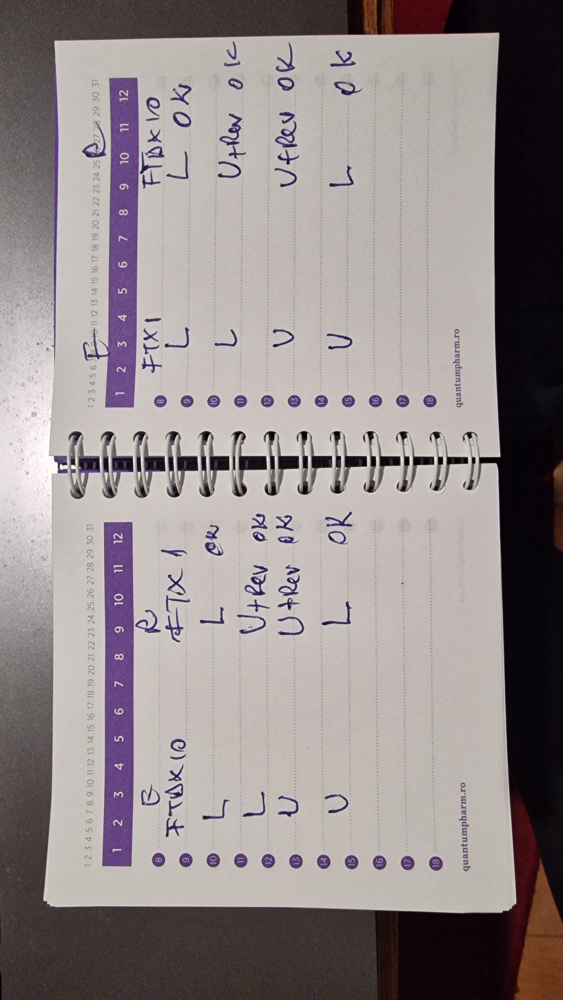

# Patch-uri pentru aplicatia Android (Yaesu-FTX1-CAT-Control)

Repo-ul Android il intretine Eugen; aici sunt doar propuneri, de aplicat cu `git apply` in radacina lui.

| Patch | Ce face | Stare |
|---|---|---|
| `RttyDemodulator.patch` | `RttyDemodulator.java` de la versiunea initiala pana la `65fd101` (AFC, Matched Filter, volant) | aplicat deja in Android (`refactorizare_claude_2`); pastrat ca referinta |
| `DeepRtty.patch` | DeepRTTY: textul gri fara gol si resetarea ca marcaj in coada | aplicat in Android (`9910082` pe `refactorizare_claude_2`) |
| `fsk-rtty-u.patch` | emisia FSK inversata in RTTY-U | **respins** - testul pe statii arata ca emisia era deja corecta (vezi mai jos) |
| `atune-polaritate.patch` | A-TUNE detecteaza singur care ton e Mark si pune NORM/REV (ca RttyDecoder pe PC) | aplicat **cu corectii** in Android (`7ff7b6b` pe `refactorizare_claude_2`) - vezi „Aplicat in Android cu corectii" |
| `atune-qsy.patch` | dublu tap pe A-TUNE: statia pe frecventa corespondentului pentru emisie (ca RttyDecoder pe PC) | aplicat **cu corectii** in Android (`7ff7b6b`, impreuna cu cel de sus) |

## DeepRtty.patch

Se aplica pe `refactorizare_claude_2` (`65fd101`) si pe `master` (`ea922b9`) - fisierele DeepRTTY nu
s-au mai schimbat de la `7c2c705`. Atinge doar Kotlin-ul DeepRTTY si testul lui; API-ul
`DeepRttyReceiver` (porneste/opreste/reseteaza/alimenteaza/listener) ramane acelasi, deci
`EcranRttyDroid.java` nu se schimba.

1. **`DeepRttyStream.preview()`** - coada neconfirmata (textul gri) era doar fereastra de final de
   12 s; tokenii ultimei ferestre complete dintre textul confirmat si inceputul ferestrei de final
   (pana la ~4 s) nu apareau nicaieri pana la urmatoarea confirmare. Acum coada = tokenii inca
   neconfirmati ai ultimei ferestre (`OverlapMerger.pendingTokens`, getter nou) pana la zona sigura a
   ferestrei de final, plus fereastra de final de acolo incolo.
2. **`DeepRttyReceiver`** - resetul era un flag partajat, iar firul de decodare golea apoi toata
   coada, inclusiv blocurile sosite *dupa* reset (la pornire si la fiecare reacordare). Acum resetul
   e un marcaj in coada, in ordine cu audio-ul; la pornire stream-ul se reseteaza direct.

Verificat (proiect JVM separat, Kotlin 1.9.24, onnxruntime 1.27.0, cu inlocuitori pentru
Context/Log/SystemClock/InferenceWrapper):
- test nou `DeepRttyTest.coadaNeconfirmataFaraGol` (semnalul taiat la inceput cu 0-1.5 s, ca sa mute
  grila ferestrelor): pe codul vechi pica deja la 0 s ("...BROWN FOQWERTYUIOP" - se pierde
  "X JUMPS OVER THE LAZY DOG" si shift-ul FIGS), cu patch-ul trece la toate;
- `DeepRttyTest` existent (NORM -3/-6/-9 dB, REV -6 dB) si `RttyDemodulatorTest` neschimbate;
- receptorul complet (doar in scratchpad, nu se poate testa in testele unitare Android): pornire cu
  tot audio-ul imediat, in ritm, si reset la mijloc - pe codul vechi textul confirmat + gri pierdea
  "JUMPS OVER THE LAZY DOG" in 7 din 7 rulari, cu patch-ul 7 din 7 complete. Cursa de la pornire nu
  s-a putut provoca pe Linux (in C# aparea doar pe Windows); reparatia ei e prin constructie.

## fsk-rtty-u.patch - RESPINS (test pe statii, 2026-11-04)

### Ipoteza patch-ului

Emisia FSK din aplicatie ar fi buna in RTTY-L, dar in RTTY-U statia ar inversa tonurile (Mark pe
frecventa RF mai mica), deci receptorul ar trebui sa dea REV. Patch-ul inversa pinul FSK cand statia e
in RTTY-U: `polaritate = NORM/REV XOR RTTY-U` (modul din raspunsul CAT `MD0x`, x = `9`), in
`trimiteCodBaudotMetronom` si la idle-ul pe Mark fara diddle (`EcranRttyDroid.java`). Patch-ul ramane
aici doar ca referinta; **nu se aplica**.

### Testul (Eugen, YO9VA)

- FTDX10: emisie si receptie direct cu statia (tastatura/decodorul intern);
- FTX-1: emisie (pin FSK) si receptie cu aplicatia YaesuCATControlADV (FTX-1 nu are decodor intern);
- ambele statii cu setarile default; **toate emisiile pe NORM**; REV s-a pus doar la receptie, unde
  era nevoie.



| Emite (NORM) | Receptioneaza | FTDX10 -> FTX-1 + aplicatia | FTX-1 + aplicatia -> FTDX10 |
|---|---|---|---|
| RTTY-L | RTTY-L | OK pe NORM | OK pe NORM |
| RTTY-L | RTTY-U | OK doar cu REV | OK doar cu REV |
| RTTY-U | RTTY-U | OK doar cu REV | OK doar cu REV |
| RTTY-U | RTTY-L | OK pe NORM | OK pe NORM |

### Concluzii

1. **Cele doua tabele sunt identice**: FTX-1 + aplicatia se comporta exact ca FTDX10 singur.
2. **Emisia e corecta in ambele moduri**: la ambele statii semnalul din aer e acelasi in RTTY-L si in
   RTTY-U (receptorul in RTTY-L il citeste pe NORM indiferent de modul emitatorului). Aplicatia nu
   are nevoie de nicio inversare suplimentara la emisie in RTTY-U.
3. **Receptia in RTTY-U cere REV** - la decodorul intern al FTDX10 la fel ca la aplicatie. E
   comportamentul statiilor Yaesu cu setarile default, nu un bug al aplicatiei.
4. `fsk-rtty-u.patch` ar fi **stricat** emisia FTX-1 in RTTY-U pe NORM (ar fi inversat-o). Pe
   combinatia RTTY-U + REV ar fi dat din intamplare semnal corect, dar doar pentru ca anula cuplajul
   de la punctul 5.
5. **Problema reala din aplicatie**: butonul NORM/REV schimba si receptia, si emisia
   (`demod.regimReverseSoftware` e folosit si de `trimiteCodBaudotMetronom`). Cazul tipic: in RTTY-U
   pui REV ca sa citesti statia, raspunzi fara sa treci inapoi pe NORM, iar emisia iese inversata si
   corespondentul nu te mai decodeaza.

**Meniurile statiilor:**
- **FTDX10** are in meniu setari NORM/REV **separate** pentru receptie si pentru emisie (plus decodor
  RTTY intern si butoane de macrouri RTTY);
- **FTX-1** are meniul mai sarac: fara decodor RTTY, fara macrouri RTTY, iar NORM/REV **doar pentru
  emisie**. Receptia RTTY o face numai aplicatia, deci butonul NORM/REV din aplicatie tine locul
  setarii de RX pe care FTX-1 nu o are.

Yaesu trateaza deci polaritatea de RX si de TX separat; aplicatia le leaga de acelasi buton.

**Propunere (aplicata in Android: `49f80a3` pe `refactorizare_claude_2`; in RttyDecoder: `886ac3e`):** emisia FSK sa nu mai urmeze butonul
NORM/REV - pinul pleaca mereu cu polaritatea normala (Mark = pin activ); REV ramane doar pentru
receptie. Emisia inversata, cand chiar e nevoie, se face din setarea
de TX din meniul statiei (exista la ambele); o optiune „TX REV” si in aplicatie nu e necesara si ar
putea da o dubla inversare.

### Observatii

- Un test anterior, mai putin sistematic, parea sa arate ca FTDX10 in RTTY-U decodeaza fara REV o
  emisie FTX-1 din RTTY-L; tabelul de mai sus (randul RTTY-L -> RTTY-U cere REV) il contrazice si e
  cel de referinta.
- **RttyDecoder (programul de PC)**: commit-ul `a870049` („Emisia FSK corecta si in RTTY-U",
  `RttyFskTransmitter.RigInvertsTones`) se bazeaza pe aceeasi ipoteza. Testul de mai sus nu a acoperit
  emisia FTDX10 prin pinul FSK al programului de PC, doar emisia directa a statiei; dar daca statia se
  comporta la fel cand e comandata prin pin (cum se vede la FTX-1), si `a870049` inverseaza gresit in
  RTTY-U. **De reverificat pe statie** inainte de a-l pastra (inainte de el, in modul RTTY al statiei
  pinul deja nu urma REV-ul receptiei - adica exact propunerea de mai sus). *Rezolvat:* `886ac3e`
  anuleaza `a870049` - pinul FSK pleaca mereu normal, NORM/REV e doar pentru receptie; inversarea
  emisiei din meniul statiei sau din bifa „Inverseaza pinul FSK" (implicit oprita).

## atune-polaritate.patch

Util mai ales cu **FTX-1**: nu are decodor RTTY si nici setare NORM/REV pentru receptie, deci
polaritatea de RX o stie doar aplicatia - iar in RTTY-U (sau cand corespondentul emite inversat)
trebuia pus REV de mana. Acum A-TUNE il pune singur, ca in RttyDecoder (programul de PC).

**Cum se stie care ton e Mark.** In spectru cele doua tonuri arata la fel, dar in timp nu: cu
polaritatea corecta fiecare caracter incepe cu bitul de start pe Space si se termina cu stopul de
1.5 biti pe Mark, deci caracterele „se incadreaza"; cu polaritatea gresita incadrarea esueaza. Pe
ultimele 5 s de audio se incearca ambele ipoteze si castiga cea clar mai buna (minim 6 caractere
incadrate, diferenta de scor de minim 0.15, scorul castigator de minim 0.5). Pe zgomot sau semnal
prea scurt rezultatul e nesigur si NORM/REV ramane cum era (A-TUNE se poarta ca inainte).

Ce schimba:
1. **`RttyPolarity.java`** (nou) - portul din C# (`src/RttyDecoder.Core/Dsp/RttyPolarity.cs`),
   acelasi algoritm si praguri: doua rezonatoare complexe de 35 Hz pe cele doua tonuri, decizie de 8
   ori pe bit, apoi incadrarea UART cu ambele ipoteze. Oscilatoarele sunt fazori rotiti (fara
   cos/sin pe esantion): 5 s la 48 kHz se calculeaza in cateva milisecunde, pe firul A-TUNE.
   Contine si `Istoric`, inelul sincronizat cu ultimele 6 s de audio.
2. **`EcranRttyDroid.java`**:
   - firul de receptie scrie fiecare bloc audio si in `istoricAudioRtty` (golit la START);
   - `executaAutoTuneMecanic`: dupa perechea de tonuri din FFT (neschimbata), detectia pe ultimele 5 s
     intre tonul de jos si tonul de jos + 170 Hz; pe firul UI se pun `regimReverseSoftware` si
     `frecventaTunedBaza` (Mark-ul real: tonul de jos pe NORM, cel de sus pe REV), apoi
     `sincronizeazaSetariReceptie()` (butonul NORM/REV si waterfall-ul se actualizeaza ca la click);
   - toast-ul spune si polaritatea: `Auto-Tune: 2125 Hz, REV`, cu „(polarity uncertain ...)" cand
     detectia nu e sigura.
3. **`RttyPolarityTest.java`** (nou, JVM) - pe generatorul din `RttyDemodulatorTest`: NORM si REV
   curat; la 6 dB SNR cu acordul A-TUNE abatut cu -8/0/+8 Hz (binurile FFT au 15.6 Hz), 3 seed-uri;
   tastare manuala cu pauze; zgomot fara semnal si semnal sub 1 s -> nesigur; inelul `Istoric`.

Emisia nu e atinsa: dupa `49f80a3` pinul FSK nu mai urmeaza NORM/REV, deci REV-ul pus de A-TUNE
schimba doar receptia.

Verificat: `RttyPolarityTest` 7/7 cu JUnit 4.13.2 (javac fara SDK Android, cu `RttyDemodulator`,
`BaudotCodec` si `RttyDemodulatorTest`); `EcranRttyDroid.java` doar verificat sintactic (fara SDK
Android aici) - de compilat in Android Studio. `git apply --check` trece pe `49f80a3` si pe `ea922b9`.

QSY-ul de la dublu tap pe A-TUNE e in `atune-qsy.patch` (mai jos).

## atune-qsy.patch

Se aplica peste `atune-polaritate.patch`:

```
git apply atune-polaritate.patch
git apply atune-qsy.patch
```

In modul RTTY al statiei (FSK) tonurile receptiei sunt fixe (Mark pe 2125 Hz, shift 170), iar
statia emite exact unde e acordata. Daca corespondentul se aude cu Mark-ul in alta parte (A-TUNE
acordeaza decodorul acolo), raspunsul tau pleaca alaturi de el. Ca in RttyDecoder:

- **tap pe A-TUNE**: ca pana acum (acord + NORM/REV), iar in subsidiar se calculeaza unde trebuie
  dusa statia; toast-ul spune `TX: radio to 3500.950 kHz (-50 Hz) - double-tap A-TUNE`;
- **dublu tap** (doua tap-uri in 450 ms): statia se muta acolo (`FA%09d;`), decodorul trece pe Mark
  2125 Hz si emisia pleaca pe frecventa corespondentului. Dublu tap-ul merge si direct, fara un tap
  inainte: daca vine cat A-TUNE inca lucreaza, QSY-ul se face imediat ce termina.

Calculul (ca HamRig `RigMath.QsyDial`): in RTTY-L statia lucreaza ca in LSB (ton audio mai sus =
frecventa RF mai jos), in RTTY-U ca in USB; noua frecventa = VFO -/+ (Mark auzit - 2125). Pe PC
verificat pe statie: emisia a cazut la 2 Hz de corespondent.

Ce schimba:
1. **`RttyQsy.java`** (nou):
   - `frecventaPentruEmisie(vfo, codMod, markHz)` - doar in RTTY-L (`MD06`) si RTTY-U (`MD09`);
   - `rafineazaTonJos(...)` - FFT-ul de la A-TUNE are binuri de 15.6 Hz (pana la ~8 Hz abatere),
     destul pentru decodor (are AFC) dar prea grosier pentru QSY. Se cauta in +-12 Hz, pas 0.5 Hz,
     maximul puterii celor doua tonuri pe ultimele 2 s (Goertzel cu fereastra Hann). Tonul rafinat
     se foloseste si la acordul decodorului si la detectia polaritatii.
2. **`EcranRttyDroid.java`**:
   - A-TUNE cere `MD0;` si `FA;` la inceput (receptia RTTY porneste cu `AI0`, deci statia nu le mai
     trimite singura); raspunsurile ajung in `StareRadio` pana termina FFT-ul (~0.3 s);
   - `laTapAtune()` deosebeste tap-ul de dublu tap; `pregatesteQsy()` calculeaza, `executaQsyAtune()`
     muta statia;
   - QSY-ul nu se face: in emisie; daca statia nu e in RTTY-L/U (toast-ul o spune); daca rezultatul are
     peste 30 s sau statia s-a mutat intre timp (`StareRadio` alta decat la calcul) - atunci se cere
     un A-TUNE nou. Sub 3 Hz diferenta: „Radio already on the TX frequency".
3. **`RttyQsyTest.java`** (nou, JVM): RTTY-L / RTTY-U in ambele directii, deja pe frecventa, alte
   moduri si frecventa necunoscuta -> nimic; codul de mod; acordul fin pe NORM si REV cu tonul real
   la -7.3..+7.8 Hz de binul FFT (6 dB SNR) si cu tastare manuala - mereu la sub 1 Hz.

Verificat: `RttyQsyTest` 8/8 si `RttyPolarityTest` 7/7 (JUnit 4.13.2, fara SDK Android);
`EcranRttyDroid.java` doar verificat sintactic - de compilat in Android Studio. Cele doua patch-uri se
aplica in ordine pe `49f80a3` si pe `ea922b9`.

De verificat pe statie: RTTY-U (pe PC directia ca USB a mers - 2 Hz); mutarea VFO-ului cu
`FA` cand statia e pe VFO-B / split (patch-ul muta mereu VFO-A, ca restul aplicatiei).

## Aplicat in Android cu corectii (`7ff7b6b`, 2026-11-05)

Cele doua patch-uri A-TUNE s-au aplicat pe `refactorizare_claude_2`, dar testate pe inregistrarile
reale (W6IWI 14089 cu RYRY, 14086, QRN 7086 - WAV-uri la 48 kHz, ferestre de 5 s ca la A-TUNE; REV
sintetizat prin oglindirea spectrului in jurul centrului perechii) au aratat doua probleme. Codul din
Android difera deci de patch-uri in urmatoarele puncte:

### 1. Polaritatea: duratele inaintea incadrarii (`RttyPolarity.java`)

Incadrarea UART singura se insela pe **RYRY**: bitii alternanti se incadreaza aproape la fel de bine
si cu polaritatea inversata. Acum decide intai **duratele**: bitul de stop are 1.5 biti, deci doar
Mark-ul are rulari de lungime fractionara (1.5, 2.5... biti); rularile de Space sunt mereu numere
intregi de biti. Pentru fiecare ton se numara ce fractie din rularile de 1.2-8 biti (fara prima si
ultima, taiate de fereastra) au partea fractionara intre 0.3 si 0.7; decide daca sunt minim 16 rulari
si diferenta e de minim 0.20. Altfel (de ex. stop de 1 sau 2 biti) ramane incadrarea, cu praguri mai
stricte: 12 caractere, diferenta 0.30, scor minim 0.6.

| Inregistrare (ferestre de 5 s, NORM + REV) | Patch-ul original | Cu corectia |
|---|---|---|
| 14089 (RYRY) | 10 gresite din 180 decise | 0 gresite din 402 |
| 14086 | 4 gresite | 0 gresite |
| QRN 7086 | 0 gresite | 1 din 430 (pe varianta oglindita) |
| zgomot fara semnal (1000 ferestre) | - | 0 decizii |

Am incercat si verificarea „stop inainte de start" pe incadrare - a iesit mai rau, deci respinsa.

**Acelasi defect e si in C#** (`RttyPolarity.cs`) - de portat corectia si pe PC.

### 2. Tonul pentru QSY: discriminator de faza in loc de maximul puterii (`RttyQsy.java`)

Maximul puterii Goertzel (+-12 Hz, pas 0.5) depinde de continut (RYRY fata de text): pe semnal real
tonul sarea cu 5-10 Hz intre ferestre, deci QSY-ul ar fi dus statia alaturi. Acum
`rafineazaTonJos` foloseste un discriminator de faza pe fiecare ton, ca AFC-ul demodulatorului:
mixare in banda de baza pe cele doua tonuri, doi poli de 50 Hz in cascada, decizie de 8 ori pe bit;
cat timp un ton domina clar (4x in putere, doua decizii la rand) rotatia fazei lui da abaterea de
frecventa; cele doua tonuri se mediaza ponderat; doua treceri, maxim +-15 Hz pe trecere.

| Abaterea tonului intre ferestre (p90) | Goertzel (patch) | Discriminator |
|---|---|---|
| 14089 | 10.8 Hz | 1.0 Hz |
| 14086 | 6.8 Hz | 0.4 Hz |
| QRN 7086 | 6.0 Hz | 0.8 Hz |

Cap-coada (bin FFT -> rafinare -> polaritate) pe 14089: 0 decizii gresite din 1220, tonul la p90
sub 1.9 Hz de cel real. **Posibil acelasi defect si in C#** la rafinarea tonului pentru QSY - de
verificat.

### 3. `EcranRttyDroid.java`

- firul A-TUNE e in `try/catch`: la exceptie butonul nu mai ramane blocat (`atuneInCurs`), toast
  „Auto-Tune error - try again.";
- la dublu tap se recere `FA;` si dupa 400 ms se muta statia doar daca frecventa e aceeasi ca la
  calcul (in RTTY receptia merge cu `AI0`, deci `StareRadio` nu afla singur ca statia s-a mutat);
  altfel „The radio moved since A-TUNE - tap A-TUNE again.".

### Teste

`RttyPolarityTest` 8/8 (nou: RYRY pe NORM si REV, curat / 10 dB / 6 dB, 3 seed-uri; zgomot pe 50 de
seed-uri), `RttyQsyTest` 8/8 neschimbat; toate testele unitare ale aplicatiei 60/60; APK-ul se
compileaza.

De verificat pe statie: A-TUNE pune singur REV in RTTY-U; dublu tap muta statia si FTDX10 decodeaza
pe frecventa lui; comportamentul pe VFO-B / split.
